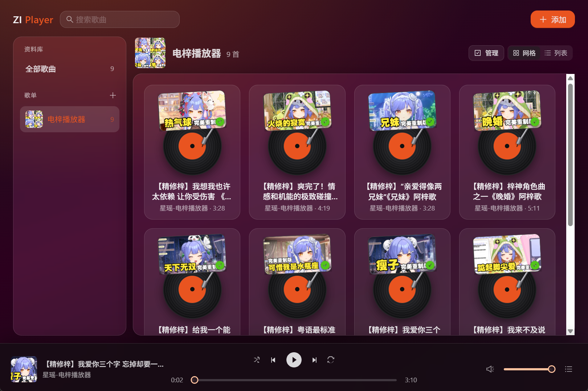

# ZI Player

ZI Player 是 Windows 和 Linux 上的桌面播放器。它把 B 站视频链接变成歌曲卡片（封面、歌曲、名称），并播放其中的音频。

## 能做什么

- 识别 `bilibili.com` 视频链接和 `b23.tv` 短链
- 用卡片展示歌曲，播放时封面旋转
- 添加、删除、重命名和搜索
- 打开窗口时，若剪贴板中有 B 站链接，提示导入
- 关闭窗口后留在系统托盘
- 随窗口宽度调整卡片列数

## 下载

提供 Windows 和 Linux 安装包。

从 [GitHub Releases](https://github.com/awrff/zi-player/releases/latest) 下载最新版本。

| 系统 | 文件 |
| --- | --- |
| Windows | `ZI Player_*_x64-setup.exe` |
| Linux | `.AppImage` 或 `.deb` |

安装前，用同一 Release 页面上的 `SHA256SUMS` 核对文件。已安装的版本会在启动时检查更新。

## 使用

1. 安装并打开 ZI Player。
2. 粘贴一个 B 站视频链接并导入。
3. 点击卡片开始播放。
4. 关闭窗口后，从托盘图标再次打开。

## 缓存与卸载

- 从资料库删除歌曲时，会同时清理对应的音频、下载/转码残留和封面；仅从歌单移除不会删除这些文件。
- Windows NSIS 安装包和 Linux `.deb` 在真正卸载时会删除缓存的音频与封面，应用更新不会清空缓存。
- Windows 缓存位于 `%APPDATA%\com.jayden.zi-player`。Linux 默认位于 `$HOME/.local/share/com.jayden.zi-player`。
- 直接删除 AppImage 文件不会触发卸载清理，需要手动删除上述目录中的 `audio` 和 `covers`。如果 Linux 使用自定义 `XDG_DATA_HOME`，也需要手动清理对应位置。

## 许可证

本项目以 [MIT](LICENSE) 发布。随包分发的 yt-dlp（Unlicense）和 ffmpeg（GPL-3.0）见 [THIRD-PARTY-NOTICES.md](THIRD-PARTY-NOTICES.md)。
